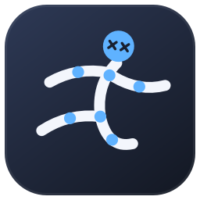
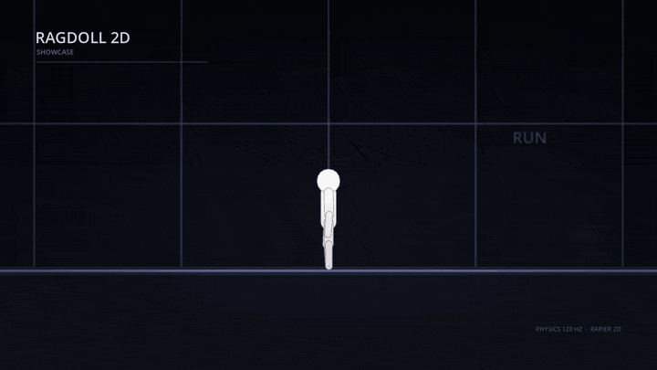

# Ragdoll 2D



A procedural 2D humanoid ragdoll controller for **Godot 4**. Ten physics bodies,
one capsule controller and a small PD pose system: no skeleton, no animation
clips, no `AnimationPlayer`.

The figure can stand, walk, jump, crawl, get back up and go completely limp. All
of that is driven by forces and joint limits, so it reacts physically to terrain,
pushes and impacts.

The reusable component lives in [`addons/ragdoll2d`](addons/ragdoll2d). The
project also contains a playable demo arena and a scripted one-take showcase
([`demo/showcase.tscn`](demo/showcase.tscn)); neither is part of the addon.



## Features

- Ten-body humanoid: head, torso, upper and lower arms, upper and lower legs.
- Standing and walking driven by a kinematic control body and two spring winches.
- Distance-driven gait, so feet do not skate at different speeds or figure sizes.
- Jumping with a faded air pose.
- Crawling with a steerable push on every limb.
- Stand-up search: the upright capsule is tested against the physics world before
  the figure tries to get up.
- Ragdoll mode: all pose control and control joints off.
- Per-limb `PhysicsMaterial` and collision layers set on the scenes.
- Input-agnostic: the ragdoll never reads the `Input` singleton.
- Impact and hurt sounds plus blood via the included `Ragdoll2DImpactFx` child.
- Signals for impacts and state changes when you want custom presentation.

## Requirements

- **Godot 4.7 or newer.**
- **120 Hz physics required** for the included tuning
  (`physics/common/physics_ticks_per_second=120`). The controller derives its
  gains from the tick rate, but the default tuning was authored at 120 Hz.
- **Rapier2D 0.36.0** is the backend the included tuning was authored against;
  it is **not** bundled. Install the pinned build with `tools/fetch_rapier.sh`
  from a bash shell (Linux or Git Bash on Windows), then select it under
  `physics/2d/physics_engine`. Other 2D backends work, but behavior may differ.

## Installation

Copy the folder `addons/ragdoll2d/` into your project's `addons/` directory. You
do **not** need to enable an editor plugin; the `class_name` scripts register
themselves and the scenes/resources can be used directly. A no-op editor plugin
is included only so the addon can also be enabled from the Plugins list without
an error.

For a Git-based workflow, add this repository as a submodule or copy only the
`addons/ragdoll2d/` folder. The demo and tests are outside the addon.

## Quick start

```gdscript
extends Node2D

var ragdoll: Ragdoll2D

func _ready() -> void:
    ragdoll = preload("res://addons/ragdoll2d/scenes/ragdoll_2d.tscn").instantiate()
    add_child(ragdoll)
    ragdoll.is_active = true
    ragdoll.impacted.connect(_on_ragdoll_impacted)
    ragdoll.state_changed.connect(_on_ragdoll_state_changed)

func _physics_process(_delta: float) -> void:
    ragdoll.set_move_axis(Input.get_axis("move_left", "move_right"))
    if Input.is_action_just_pressed("jump"):
        ragdoll.request_jump()

func _on_ragdoll_impacted(pos: Vector2, normal: Vector2, severity: float) -> void:
    # Spawn dust, play a thud, apply damage, ...
    pass

func _on_ragdoll_state_changed(state: Ragdoll2D.State) -> void:
    print("new state: ", state)
```

`set_move_axis()` expects `-1…1` and only has an effect while `is_active` is true
and the figure is conscious. `request_jump()` is consumed by the next physics
tick; a jump requested in the air is dropped.

The default scene already has a `Ragdoll2DFigureType` assigned. To create a
different body, duplicate `addons/ragdoll2d/resources/standard/standard_type.tres`
(and the `Ragdoll2DLimbSpec` resources it points at) and assign the new type in the
inspector.

## API

| Member | Description |
| --- | --- |
| `figure_type: Ragdoll2DFigureType` | Body layout and tuning. Changes are applied live. |
| `is_active: bool` | Gate for player input. Does not make the body dynamic. |
| `set_move_axis(axis: float)` | Steering input, clamped to `-1…1`. |
| `request_jump()` | Queue a jump for the next physics tick. |
| `set_standing_pose(duration: float) -> bool` | Place the figure upright and fade the pose in over `duration` seconds. Returns `false` and crawls if there is no room. |
| `start_crawling(direction: float = 0.0)` | Collapse into the steerable crawl. A non-zero `direction` sets the facing: positive right, negative left. |
| `let_loose()` | Drop all control: ragdoll mode. |
| `get_state() -> State` | `STANDING`, `CRAWLING` or `RAGDOLL`. |
| `is_grounded() -> bool` | At least one foot ray touches terrain. |
| `is_conscious() -> bool` | Standing with every winch fully reeled in. |
| `can_stand_up() -> bool` | Whether the upright capsule fits nearby. Poll it, it costs physics queries. |
| `signal impacted(global_pos, normal, severity)` | A limb had a hard contact; position and normal are world-space. |
| `signal state_changed(state)` | State transitioned. |

The public classes are `Ragdoll2D`, `Ragdoll2DLimb`, `Ragdoll2DLimbSpec`,
`Ragdoll2DFigureType`, `Ragdoll2DImpactFx` and `Ragdoll2DWinch`.
`Ragdoll2DWinch` is an internal helper; you normally do not touch it.

## Collision setup

`limb.tscn` puts every limb on layer **2** with mask **3**, so figures collide
with terrain on layer 1 and with other figures on layer 2. The control capsule
keeps Godot's default layer/mask and is excluded from the figure at runtime.
Change the layers on `limb.tscn` (or per instance) if your project uses different
layers.

Limbs never collide with each other (self-collision is disabled because the
figure is drawn from the side and the capsules overlap constantly). The control
body is excluded from the figure as well.

## Tuning

- `Ragdoll2DFigureType` controls walking, jumping, the control springs, crawl
  speed, acceleration, muscle and friction, and the six limb specs.
- `Ragdoll2DLimbSpec` controls shape, mass, pose spring rate, joint-limit rate,
  damping ratio and impact threshold.
- Rates are angular frequencies in rad/s, so the same number behaves the same on
  a forearm and on a thigh. Stiffness is derived from each limb's own inertia.

## Demo

Run the project and open `demo/test_arena.tscn` (it is the main scene). Controls:
left/right to move, up to jump, `L` to let loose, `S` to stand up, `N` to switch
the controlled figure, `R` to reset.

The included tuning was authored against **Rapier2D**. It is not bundled and its
folder is ignored by Git. Fetch the exact pinned build with:

```sh
./tools/fetch_rapier.sh
```

The script downloads the release, verifies its SHA-256 and installs only
`addons/godot-rapier2d/`. It skips the download if the pinned version is already
present; delete that folder to reinstall. CI runs the same script. Manual
installation of
[Rapier2D 0.36.0](https://github.com/appsinacup/godot-rapier-physics/releases/tag/v0.36.0)
also works. To use GodotPhysics2D, set `physics/2d/physics_engine` to
`GodotPhysics2D`; behavior may differ from the Rapier tuning.

The playable arena only maps input and marks the active figure. Impact sounds
and blood ship with the addon: the ragdoll scene includes an `ImpactFx` child
(`Ragdoll2DImpactFx`) that places both at the contact point. Its thresholds and
appearance are exported properties. Remove the node or disable it if your game
handles presentation itself. The showcase uses this default setup.

## Tests

The repository ships a headless smoke test. From the repository root:

```sh
godot --headless res://tests/smoke_test.tscn
```

It exits with code 0 on success and needs no display, imported audio or manual
input. It covers pre-ready properties, walking, jumping, crawling, standing up,
going limp and both signals. It runs on the project's selected 2D backend at
120 Hz; when using Rapier2D, run `./tools/fetch_rapier.sh` first.

`tools/test_addon_isolated.sh` copies only the addon, Rapier2D and the smoke
test into a temporary minimal project and runs the same test there. CI executes
it to make sure the addon does not depend on demo files or project settings.

## Releasing

The addon version lives in `addons/ragdoll2d/plugin.cfg` and follows
[Semantic Versioning](https://semver.org/). Bump that version, update
[`CHANGELOG.md`](CHANGELOG.md), commit, then tag and push:

```sh
git tag v0.1.0
git push origin v0.1.0
```

The tag triggers a workflow that builds `ragdoll2d-v0.1.0.zip` from
`addons/ragdoll2d` and attaches it to a GitHub release.

For the Godot Asset Library, submit the release commit. The `export-ignore`
rules in `.gitattributes` trim its repository snapshot to
`addons/ragdoll2d`.

## Project layout

```
addons/ragdoll2d/      the reusable addon
  src/                 ragdoll_2d.gd, impact_fx.gd, limb.gd, limb_spec.gd, figure_type.gd, control_winch.gd
  scenes/              ragdoll_2d.tscn, limb.tscn
  resources/standard/  the default body tuning
  sfx/                 synthesized impact and hurt sounds
demo/                  playable test arena and scripted showcase
tests/                 headless smoke test
tools/                 Rapier2D fetch and isolated addon test scripts used by CI
CHANGELOG.md           release history
```

## Limitations

- Fixed humanoid body plan: ten limbs with hard-coded roles. Quadrupeds or
  arbitrary skeletons are not supported.
- Self-collision is off by design.
- The ragdoll and its parents must stay unrotated in world space. The controller
  assumes world-up gravity and an upright stand-up capsule.
- One ragdoll per `Ragdoll2D` node; use multiple nodes for multiple figures.
- No networking or animation retargeting.
- Physics tuning is engine-dependent. The included tuning is authored for
  Rapier2D 0.36.0 at 120 Hz; other 2D backends or tick rates may behave
  differently, especially for the stand-up search.

## License

The addon and the demo code are released under the **MIT License**. See
[`LICENSE`](LICENSE). The included impact and hurt sounds are synthesized for
this addon; replace them if you want a different style. The project icon is
original artwork for this project and is covered by the MIT License.
